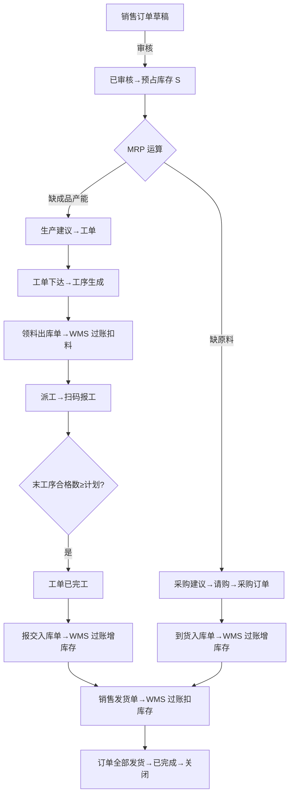
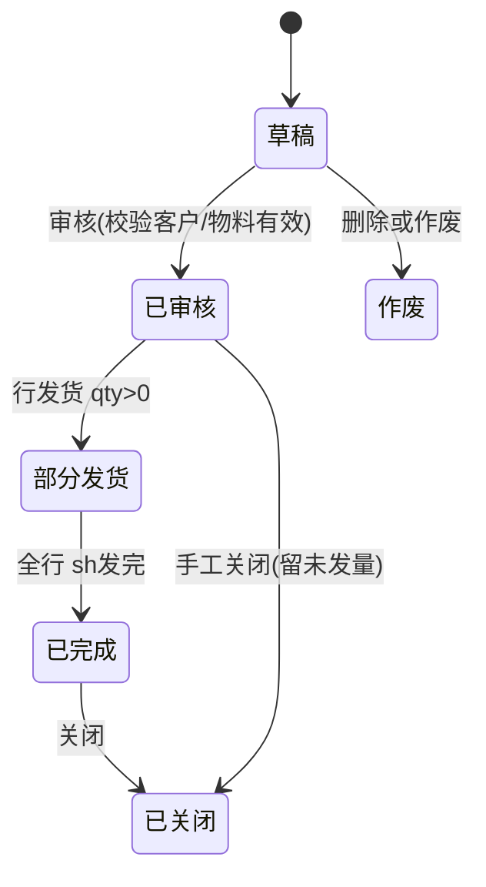
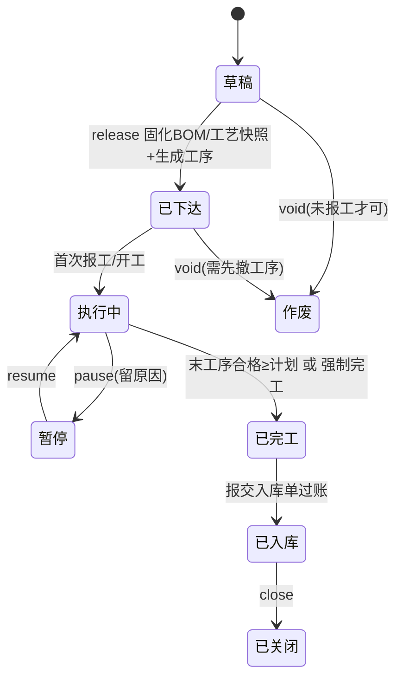
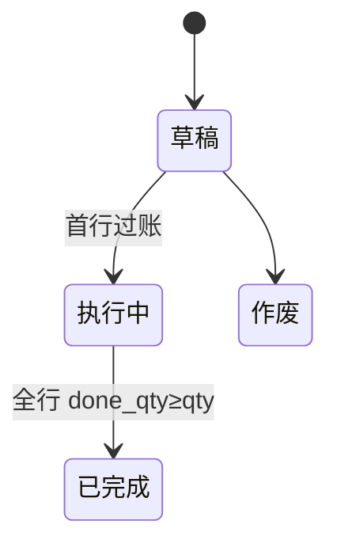

# 核心业务流程（Core Flows）

> 状态机与流程图统一用 Mermaid 维护，代码中的状态迁移必须与本文档一致（变更走 PR 同步修改）。

## 1. 端到端主流程（Order to Delivery）



## 2. 关键状态机

### 2.1 销售订单


### 2.2 工单


### 2.3 出入库单


## 3. 库存过账事务（伪代码，防超卖）

```
BEGIN
  -- 幂等检查（client_token / 单据行+数量组合）
  锁台账行: SELECT * FROM stocks
            WHERE factory_id=? AND warehouse_id=? AND material_id=? AND batch_no=?
            FOR UPDATE;  -- 无行则 INSERT ... ON CONFLICT DO NOTHING 后重取
  校验: 出库时 qty_on_hand - qty_reserved(本次核销量) >= qty  (负库存参数)
  写流水: INSERT stock_movements(before_qty, after_qty, biz_type, source_doc)
  更新台账: UPDATE stocks SET qty_on_hand = after_qty
  回写单据行 done_qty / 单据状态机推进
  核销预占(如有): UPDATE stock_reservations ...
  写审计
COMMIT
```

## 4. MRP 计算算法（M1 简化全量）

```
输入: 已审核销售订单(净需求起点), 可用库存, 在途(已审未入库采购), 在制(未完工工单产出)
1. 计算低层码 LLC(material)
2. 按销售订单行生成毛需求 P0: (material, qty, due_date)
3. 按层从低到高处理:
   net = 毛需求 - (可用库存 + 在途 + 在制)   // 数量守恒逐层滚动
   if net > 0:
     生成计划建议 (生产建议 or 采购建议, qty=net, date=due-提前期)
     按 BOM 展开子项毛需求: child_qty = net * (1+损耗率) * 用量
4. 输出建议列表(含需求来源链, 供穿透)
```

## 5. 批次追溯链

```
成品批次 ──报交──▶ 工单 ──领料单──▶ 原料批次 ──采购入库──▶ 供应商
   ▲                                                │
   └────────── 工序报工(人/时间/不良) ◀──────────────┘
查询入口: /trace/batch/:batchNo 与 /trace/work-order/:id
```
